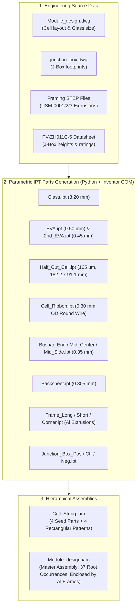

# Project Handover Document: 144 Half-Cut Cell Commercial PV Solar Module 3D Parametric CAD Automation

**Target Audience:** Succeeding Antigravity (AGY) CLI Agents / CAD Automation Engineers  
**Created Date:** 2026-11-22  
**Primary Working Directory:** [`C:\projects\3D`](file:///C:/projects/3D)  
**Main Master Assembly:** [`C:\projects\3D\Module_design.iam`](file:///C:/projects/3D/Module_design.iam)  
**Cell String Sub-Assembly:** [`C:\projects\3D\Cell_String.iam`](file:///C:/projects/3D/Cell_String.iam)  
**Key Renderings Directory:** [`C:\projects\3D\renders`](file:///C:/projects/3D/renders)  

---

## 1. Project Overview & Objectives

This project automates the creation of a complete, high-fidelity, parametric 3D CAD model of a **144-half-cut-cell commercial bifacial/monofacial photovoltaic (PV) solar module** using **Autodesk Inventor 2026** via the **Python COM Automation API (`win32com.client`)**.

The model was synthesized from 2D manufacturing drawings ([`Module_design.dwg`](file:///C:/projects/3D/Module_design.dwg), [`junction_box.dwg`](file:///C:/projects/3D/junction_box.dwg)), manufacturer STEP files ([`Framing\`](file:///C:/projects/3D/Framing)), and equipment datasheets ([`Data Sheet PV-ZH011C-5 20A 25 30A - MC4.pdf`](file:///C:/projects/3D/Data%20Sheet%20PV-ZH011C-5%2020A%2025%2030A%20-%20MC4.pdf)).



---

## 2. Complete Historical Revision Log

| Step Index | User Requirement / Feedback | Technical Problem Identified | Final Solution Implemented |
| :--- | :--- | :--- | :--- |
| **Step 582 ~ 656** | `Module_design.dwg` 2D 도면을 기반으로 3D 솔라 패널 어셈블리 생성 요청 | 2D DWG 레이아웃 좌표 추출 및 유리, EVA, 셀, 백시트 적층 모델링 필요 | `accoreconsole.exe`로 DXF 변환 후 블록 및 선형 좌표 추출, 초기 `Module_design.iam` 빌드 |
| **Step 705** | 각 셀 전면/후면 리본이 Z-스텝으로 다음 셀과 연결되고 끝단에 버스바가 배치되도록 수정 요청 | 기존 모델은 평면 단일 리본으로 실제 셰이딩/인터커넥션 구조와 상이 | 전면 패드 $\rightarrow$ 셀 갭(1.4mm) $\rightarrow$ 후면 패드로 이어지는 Z-스텝 스윕 리본 모델링 및 버스바 3종 구현 |
| **Step 729** | 개별 리본 파트 배치 대신 파라메트릭 어레이(Pattern)로 재구성 요청 | 셀 144개, 리본 120개가 개별 구속조건으로 배치되어 파일 크기 급증 및 파라미터 연동 불가 | `Cell_String.iam`에 4개 시드(Seed) 오커런스만 배치 후 `OccurrencePatterns.AddRectangularPattern` 4종 적용 |
| **Step 938** | 사각 리본을 라운드 와이어(Round Wire) 형태로 변경, 구리 심선 및 Sn/Pb 코팅 분리 요청 | 원형 와이어 및 코팅 레이어 분리 모델링 필요 | 구리 코어(`Copper_Core`)와 외곽 솔더 코팅(`SnPb_Coating`)의 동심원 2-바디(Dual-body) 스윕 구현 |
| **Step 992** | 버스바 리본 규격 확정 (두께 0.31mm Cu + 0.02mmx2 코팅 = 0.35mm, 폭: 중앙 6mm, 상하단 5mm) | 버스바 두께 및 폭 규격화 필요 | `Busbar_End.ipt` (W: 5mm), `Busbar_Mid_Center.ipt` (W: 6mm), `Busbar_Mid_Side.ipt` (W: 6mm) 생성 |
| **Step 1006** | EVA 및 백시트 두께 확정: 전면 EVA 0.50mm, 후면 EVA 0.45mm, 백시트 0.305mm | 레이어 적층 Z/Y 두께 동기화 필요 | `EVA.ipt` (0.50mm), `2nd_EVA.ipt` (0.45mm), `Backsheet.ipt` (0.305mm) 파라미터 업데이트 |
| **Step 1026** | **셀 리본 와이어 치수 수정:** 구리 코어 Ø0.27mm + 전 둘레 코팅 0.015mm = **총 외경 Ø0.30mm** | 이전 계산식에서 코팅 두께가 0.15mm로 오적용되어 총 외경이 0.57mm로 과대 모델링됨 | `Cu_Dia = 0.27mm`, `Coating_Thickness = 0.015mm`, `Wire_OD = 0.30mm`로 완벽 수정 |
| **Step 1043 ~ 1198** | `Framing/` 폴더의 STEP 파일(Long/Short Frame, Corner Key) 및 `junction_box.dwg` 3D 모델링 및 어셈블리 결합 요청 | STEP 파일 파싱 및 회전/배치, 정션박스 3개(Split J-Box) 형상 구현 필요 | `USM-0001-01.step`, `USM-0002-00.step`, `USM-0003-00.step` 임포트 후 `Frame_Long.ipt`, `Frame_Short.ipt`, `Frame_Corner.ipt` 생성 |
| **Step 1203 ~ 1253** | 롱프레임/숏프레임 조립 방향 일치 검증 요청 | Glass 가로/세로 축 정의(X: 1128mm 너비, Z: 2272mm 길이)와 프레임 배치 축이 90도 교차됨을 발견 | 프레임 회전 매트릭스 재계산: `Frame_Long`을 Z축(2278mm), `Frame_Short`를 X축(1134mm)으로 매핑하고 슬롯 높이 Y=[0, 5.57]mm에 완벽 안착 |
| **Step 1254 ~ 1275** | 코너 키 4개 삽입 및 최종 렌더링 완료 | 프레임 사각 모서리 체결 및 정션박스 케이블 인출 방향 확인 | 프레임 하부 캐비티에 `Frame_Corner.ipt` 4개 안착, 전면/후면 고해상도 렌더링 생성 |

---

## 3. 물리적 모듈 아키텍처 및 적층(Stack-up) 규격

### 3.1 전체 모듈 치수 사양
- **모듈 외형 치수 (프레임 포함):** 2,278 mm (L) × 1,134 mm (W) × 35 mm (H)
- **라미네이트 샌드위치 치수 (유리 기준):** 2,272 mm (L) × 1,128 mm (W) × 5.570 mm (T)
- **셀 구성:** 144 Half-Cut Cells (6열 × 24행 구조, 12개 스트링)
- **셀 크기:** 182.20 mm (W) × 91.10 mm (L) × 0.165 mm (T) (챔퍼: 8.69 mm)

### 3.2 글로벌 좌표계 (Global Coordinate System)
- **원점 (0, 0, 0):** 전면 강화유리(`Glass.ipt`)의 평면 중심, 수광면 표면
- **X축 (Width):** 가로 방향 (-564.0 mm ~ +564.0 mm, 총 1,128 mm)
- **Y축 (Thickness / Stack-up):** 두께 방향 (0.000 mm ~ +5.570 mm, 프레임은 -1.8 mm ~ +33.2 mm)
- **Z축 (Length):** 세로 방향 (-1,136.0 mm ~ +1,136.0 mm, 총 2,272 mm)

### 3.3 Y축 레이어 적층 상세 내역 (Stack-up Breakdown)

```
[ +Y: 후면/Back ]
  ▲ 5.570 mm ─── Backsheet 후면 (정션박스 부착면)
  │              [ Backsheet.ipt: 0.305 mm ]
  ├ 5.265 mm ─── Backsheet - 2nd EVA 접합면
  │              [ 2nd_EVA.ipt (F806PS): 0.450 mm ]
  ├ 4.815 mm ─── 2nd EVA - 버스바 접합면
  │              [ Busbar_End / Mid: 0.350 mm ]
  ├ 4.465 mm ─── 버스바 - 후면 리본 접합면
  │              [ Rear Round Wire: 0.300 mm OD ]
  ├ 4.165 mm ─── 셀 후면
  │              [ Half_Cut_Cell.ipt: 0.165 mm (165 um) ]
  ├ 4.000 mm ─── 셀 수광면 (전면)
  │              [ Front Round Wire: 0.300 mm OD ]
  ├ 3.700 mm ─── 전면 리본 - 전면 EVA 접합면
  │              [ EVA.ipt (F406PS): 0.500 mm ]
  ├ 3.200 mm ─── 전면 EVA - 강화유리 접합면
  │              [ Glass.ipt: 3.200 mm ]
  ▼ 0.000 mm ─── 전면 수광 유리 표면 (글로벌 원점 평면)
[ -Y: 전면/Front ]
```

| 레이어 명칭 | 파일명 | Y 시작 (mm) | Y 종료 (mm) | 두께 (mm) | 외관/재질 (Appearance) |
| :--- | :--- | :--- | :--- | :--- | :--- |
| **Front Glass** | `Glass.ipt` | 0.000 | 3.200 | 3.200 | Clear / Glass |
| **Front Encapsulant** | `EVA.ipt` | 3.200 | 3.700 | 0.500 | Clear / Translucent |
| **Front Round Wires** | `Cell_Ribbon.ipt` | 3.700 | 4.000 | 0.300 (OD) | Copper (Core) + Silver/Tin (Shell) |
| **Half-Cut Cells (x144)** | `Half_Cut_Cell.ipt` | 4.000 | 4.165 | 0.165 (165 um) | Satin - Midnight Blue / Silicon |
| **Rear Round Wires** | `Cell_Ribbon.ipt` | 4.165 | 4.465 | 0.300 (OD) | Copper (Core) + Silver/Tin (Shell) |
| **Interconnect Busbars**| `Busbar_*.ipt` | 4.465 | 4.815 | 0.350 | Polished Copper + Silver/Tin |
| **Rear Encapsulant** | `2nd_EVA.ipt` | 4.815 | 5.265 | 0.450 | Clear / Translucent |
| **Backsheet** | `Backsheet.ipt` | 5.265 | 5.570 | 0.305 | White / Opaque PV Backsheet |
| **Aluminium Frame** | `Frame_*.ipt` | -1.800 | +33.200 | 35.000 (외경) | Anodized Aluminium |
| **Junction Boxes (x3)**| `Junction_Box_*.ipt`| +5.570 | +22.670 | 17.100 (높이)| Smooth - Black (Polyamide) |

---

## 4. 핵심 컴포넌트 세부 모델링 사양

### 4.1 셀 및 라운드 와이어 리본 (`Half_Cut_Cell.ipt` & `Cell_Ribbon.ipt`)
- **구리 코어 (Copper Core):** 직경 `Cu_Dia = 0.27 mm`
- **도금 코팅 (Sn/Pb Coating):** 전 둘레 코팅 두께 `Coating_Thickness = 0.015 mm`
- **총 외경 (Wire OD):** `Wire_OD = Cu_Dia + 2 * Coating_Thickness = 0.30 mm`
- **셀간 간격 (Cell Gap):** 1.40 mm
- **패드 유효 길이 (Ribbon Pad Length):** 83.17 mm, 오버행: 8.00 mm
- **Z-스텝 전이:** 전면 $Y=4.000$ mm에서 후면 $Y=4.165$ mm로 1.40mm 셀 갭 사이에서 R0.5mm 필렛을 그리며 자연스럽게 굴절 전이.

### 4.2 셀 스트링 서브어셈블리 (`Cell_String.iam`)
- 개별 부품 삽입 대신 **4개의 시드(Seed) 오커런스**와 **4개의 직교 어레이(Rectangular Pattern)**를 통해 조립:
  1. `Cell_Array`: 12개 셀을 Z축 방향으로 `Cell_Pitch = 92.50 mm` (91.10 + 1.40) 간격 어레이.
  2. `Interconnect_Ribbon_Array`: 10가닥 리본을 X축 방향 `Ribbon_Pitch = 17.30 mm`, Z축 방향 11개 갭으로 2D 어레이.
  3. `Start_Ribbon_Array`: 스트링 시작단 인출선 10가닥 어레이.
  4. `End_Ribbon_Array`: 스트링 종단 인출선 10가닥 어레이.
- **스트링 배치 (총 12스트링):**
  - 상단 6스트링 ($Z \approx +560.3$ mm): $X = \pm 459.35, \pm 275.55, \pm 91.75$ mm
  - 하단 6스트링 ($Z \approx -560.3$ mm): $X = \pm 459.65, \pm 275.85, \pm 92.05$ mm
  - 인접 스트링 간 $180^\circ$ Y축 반전 배치를 통해 사행(Serpentine) 직렬 배선 구현.

### 4.3 알루미늄 프레임 구조 (`Frame_Long.ipt`, `Frame_Short.ipt`, `Frame_Corner.ipt`)
- **프로파일 단면:** 35mm 높이, 상단 라미네이트 삽입 홈(Slot 폭 6.0mm, 깊이 11.0mm).
- **슬롯 안착 높이:** 라미네이트 샌드위치가 프레임 슬롯($Y \in [0.0, 5.57]$ mm) 중앙에 완벽 삽입.
- **길이 매핑:**
  - `Frame_Long.ipt`: 2,278 mm (Z축 양측면, $X = \pm 567.0$ mm)
  - `Frame_Short.ipt`: 1,134 mm (X축 상하단, $Z = \pm 1139.0$ mm)
- **코너 체결 키:** `Frame_Corner.ipt` 4개가 4개 모서리 하부 중공 캐비티($Y \in [5.5, 35.0]$ mm, $X=\pm 564$ mm, $Z=\pm 1136$ mm)에 압입 배치.

### 4.4 정션박스 (Split 3-Part Junction Box)
- **규격:** `Data Sheet PV-ZH011C-5` 기반 3분할 독립 구조
- **베이스 치수:** 높이 12.0 mm, 커버 5.1 mm (총 높이 17.1 mm)
- **위치 좌표 (백시트 후면 $Y = 5.57$ mm, 중앙 분할선 $Z = 0.0$ mm):**
  - `Junction_Box_Positive.ipt` (+극, 케이블 인출): $X = +367.6$ mm
  - `Junction_Box_Center.ipt` (중앙 다이오드 박스): $X = 0.0$ mm
  - `Junction_Box_Negative.ipt` (-극, 케이블 인출): $X = -367.6$ mm

---

## 5. 저장소 디렉토리 및 핵심 파일 맵

```
C:\projects\3D\
├── Module_design.iam                # [Master Assembly] 37개 루트 오커런스 최종 모듈
├── Cell_String.iam                  # [Sub Assembly] 12개 셀 + 120개 리본 어레이 스트링
├── Glass.ipt                        # 전면 강화유리 (3.20 mm)
├── EVA.ipt                          # 전면 봉지재 F406PS (0.50 mm)
├── 2nd_EVA.ipt                      # 후면 봉지재 F806PS (0.45 mm)
├── Half_Cut_Cell.ipt                # 144셀 단품 (182.2 x 91.1 x 0.165 mm)
├── Cell_Ribbon.ipt                  # Z-스텝 원형 인터커넥션 리본 (OD 0.30 mm)
├── Cell_Ribbon_Start.ipt            # 스트링 시작단 리본
├── Cell_Ribbon_End.ipt              # 스트링 종단 리본
├── Busbar_End.ipt                   # 모듈 상/하단 버스바 (폭 5 mm, 두께 0.35 mm)
├── Busbar_Mid_Center.ipt            # 중앙 분할 버스바 (폭 6 mm, 두께 0.35 mm)
├── Busbar_Mid_Side.ipt              # 외곽 분할 버스바 (폭 6 mm, 두께 0.35 mm)
├── Backsheet.ipt                    # 백시트 (0.305 mm)
├── Frame_Long.ipt                   # 2,278 mm 알루미늄 롱프레임
├── Frame_Short.ipt                  # 1,134 mm 알루미늄 숏프레임
├── Frame_Corner.ipt                 # 코너 체결 키 (Corner Key)
├── Junction_Box_Positive.ipt        # +극 정션박스
├── Junction_Box_Center.ipt          # 중앙 다이오드 정션박스
├── Junction_Box_Negative.ipt        # -극 정션박스
├── Module_design.dwg                # 원본 2D 제조 도면
├── junction_box.dwg                 # 정션박스 2D 도면
├── Data Sheet PV-ZH011C-5...pdf     # 정션박스 기술 데이터시트
│
├── build_module_3d.py               # [Python Master Builder] 파트 생성 및 적층 빌드
│
├── renders\                         # [고해상도 렌더링 이미지 모음]
│   ├── module_assembled_front_final.png  # 프레임 포함 전면 아이소메트릭 뷰
│   ├── module_assembled_back_final.png   # 정션박스/프레임 포함 후면 뷰
│   ├── module_view_corner.png            # 코너 프레임 결합부 상세 뷰
│   ├── module_view_back.png              # 정션박스 배열 상세 뷰
│   ├── round_wire_end_closeup.png        # 라운드 와이어 리본 단면 확대 뷰
│   └── zstep_gap_closeup.png             # 셀간 갭 Z-스텝 와이어 확대 뷰
│
└── Framing\                         # 원본 제조사 STEP 및 SolidWorks 파일
    ├── USM-AL EXTRUSION LONG  (USM-0001-01).step
    ├── USM-AL EXTRUSION SHORT (USM-0002-00).step
    └── USM-AL EXTRUSION CORNERS (USM-0003-00).step
```

---

## 6. 스크립트 실행 및 재빌드 가이드

다른 PC에서 개발을 이어갈 경우, **Autodesk Inventor**가 설치된 환경에서 아래 스크립트들을 순서대로 실행하거나 조합하여 사용할 수 있습니다.

### 6.1 환경 요구사항
- **OS:** Windows 10/11 64-bit
- **CAD:** Autodesk Inventor 2024 / 2025 / 2026
- **Python:** Python 3.10 이상 + `pywin32` (`pip install pywin32`)

### 6.2 Inventor COM API 제어 시 주의사항 (Critical Rules)
1. **단위 체계 (Units):** Inventor COM API의 내부 기본 단위는 **길이 = cm**, **각도 = Radian**입니다.
   - 예: $3.2 \text{ mm} \rightarrow 0.32 \text{ cm}$, $180^\circ \rightarrow \pi \text{ rad}$
   - 단, `UserParameters.AddByExpression` 또는 스케치 치수 구속조건 식에 `"3.20 mm"`와 같이 명시적 단위를 전달할 경우 Inventor가 단위 문자열을 자동 파싱합니다.
2. **평면 인덱스 (WorkPlanes Item):**
   - `Item(1)` = YZ 평면 ($X=0$)
   - `Item(2)` = XZ 평면 ($Y=0$)
   - `Item(3)` = XY 평면 ($Z=0$)
3. **배치 매트릭스 (TransientGeometry Matrix):**
   - 부품 회전/이동 시 `mat.SetCoordinateSystem(origin, x_axis, y_axis, z_axis)`를 사용하여 파트 로컬 좌표축을 어셈블리 글로벌 축으로 매핑합니다.

### 6.3 주요 파이썬 빌더 스크립트 실행 명령
```powershell
# 1. 셀, 리본(Ø0.30mm), 버스바, EVA, 백시트 및 Cell_String.iam 생성 & 적층
python C:\projects\3D\build_module_3d.py

# 2. 프레임(Long 2278mm, Short 1134mm) 및 정션박스(3개) 안착
python C:\projects\3D\scratch\correct_frame_and_render.py

# 3. 4개 코너 키(Corner Keys) 압입 삽입
python C:\projects\3D\scratch\add_corner_keys.py

# 4. 고해상도 프레젠테이션 렌더링 출력 (Front & Back)
python C:\projects\3D\scratch\render_final_presentation.py
```

---

## 7. 다음 AI 에이전트(Succeeding AGY CLI)를 위한 추천 개발 과제

현재 솔라 패널의 3D 형상 모델링, 파라메트릭 어레이, 프레임 및 정션박스 조립까지 완성된 상태입니다. 다음 에이전트는 다음 기능들을 추가로 확장 개발할 수 있습니다.

1. **자동화 2D 제작 도면 (.idw / .dwg) 생성 파이프라인 개발:**
   - `DrawingDocument`를 생성하여 정면도, 배면도, 측면도 및 코너 단면 상세도(Detail View)를 자동 배치하고 치수선(2278 x 1134 x 35)을 자동 기입하는 스크립트 작성.
2. **BOM (자재명세서) & 중량 산출 자동화:**
   - 각 파트별 물성치(유리: 2.5 g/cm³, 알루미늄: 2.7 g/cm³, 구리: 8.96 g/cm³, 실리콘: 2.33 g/cm³, EVA: 0.96 g/cm³)를 지정하고 모듈 총중량(목표: 약 27.5 ~ 28.5 kg) 및 파트 리스트를 CSV/Excel로 추출.
3. **MC4 케이블 및 커넥터 모델링:**
   - 정션박스(+/-) 글랜드 홀에서 인출되는 4.0 mm² 태양광 전용 케이블(길이 1,200 mm)과 MC4 커넥터 암/수 형상 스윕 추가.
4. **Inventor Nastran 연계 풍하중/적설하중 FEA 구조해석:**
   - IEC 61215 규격 기준 전면 5,400 Pa(적설 하중), 후면 2,400 Pa(풍압 하중) 적용 시 중앙부 최대 변형량(Displacement) 및 알루미늄 프레임 응력 집중(Von Mises Stress) 시뮬레이션 자동화.
