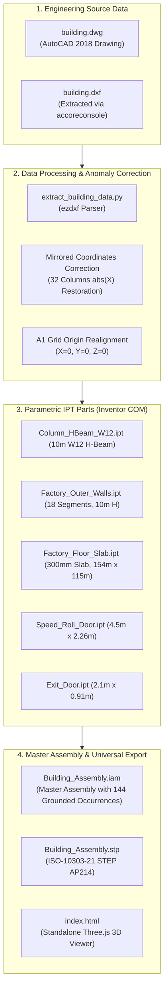

# Factory Building 3D Parametric CAD Automation & Digital Twin

**Project Workspace:** [`C:\projects\3d\Building`](file:///C:/projects/3d/Building)  
**Primary Master Assembly:** [`Building_Assembly.iam`](file:///C:/projects/3d/Building/Building_Assembly.iam)  
**Universal STEP Model:** [`Building_Assembly.stp`](file:///C:/projects/3d/Building/Building_Assembly.stp)  
**Interactive 3D Web Viewer:** [`index.html`](file:///C:/projects/3d/Building/index.html)  
**Source 2D Drawing:** [`building.dwg`](file:///C:/projects/3d/Building/building.dwg)  

---

## 1. Project Overview & Scope

This project automates the synthesis of a complete, high-fidelity, parametric 3D CAD model and WebGL-based Digital Twin of a **15,280 m² (~164,470 sq ft) commercial manufacturing factory facility** based on the 2D architectural drawing [`building.dwg`](file:///C:/projects/3d/Building/building.dwg).

The model was generated using **Autodesk Inventor 2026** via the Python COM Automation API (`win32com.client`), featuring:
- **10.0 m (10,000 mm) Clear Height** throughout all structural columns and perimeter walls.
- **132 Parametric Wide-Flange H-Beam Columns (W12×10")** with 4-hole baseplates.
- **18-Segment Continuous Perimeter Outer Walls** (305.9 mm / 12" thickness) including the **East R1~R7 3-Tier Stepped Expansion Wing**.
- **10 Industrial Door Cutouts & Assemblies** (3 Speed Roll-up doors and 7 Egress Exit doors).
- **Universal CAD Interchange (`.stp`)** in STEP AP214 format for seamless collaboration with SolidWorks, CATIA, Creo, FreeCAD, and Fusion 360.
- **Standalone WebGL/Three.js 3D Web Viewer (`index.html`)** for interactive inspection directly inside any modern web browser.



---

## 2. Key Specifications & Dimensions

| Feature / Metric | Specification | Engineering Details |
| :--- | :--- | :--- |
| **Overall Footprint (L × W × H)** | **148.30 m × 108.91 m × 10.00 m** | Includes East R1~R7 3-tier stepped expansion wing |
| **Total Enclosed Floor Area** | **~15,280 m² (~164,470 sq ft / ~4,620평)** | Expanded from base hall (~14,420 m²) |
| **Clear Ceiling / Column Height** | **10.00 m (10,000 mm / ~32.8 ft)** | Standard heavy manufacturing clearance |
| **Structural Column Profile** | **W12×10" Wide-Flange (H-Beam)** | Flange: 254.9 mm × 4.8 mm, Web: 6.4 mm, Depth: 305.9 mm |
| **Baseplate Dimensions** | **400 mm × 450 mm × 25 mm** | 4 Anchor bolt holes (Φ30.0 mm at ±51.0 mm) |
| **Total Column Count** | **132 EA** | Grids A through R (18 bays) × Grids 1 through 16 |
| **Perimeter Wall Thickness** | **305.9 mm (12.0 inches)** | 18 continuous segments, insulated panel / concrete |
| **R1~R7 Expansion Wing** | **East 3-Tier Stepped Protrusion** | Tier 1: 148.3m, Tier 2: 143.1m, Tier 3: 137.9m |
| **High-Speed Roll Doors (`SR`)** | **3 Locations** | 2,261 mm (W) × 4,500 mm (H) with top drum canister |
| **Emergency Exit Doors (`EXIT`)** | **7 Locations** | 910 mm (W) × 2,100 mm (H) single leaf with panic push-bar |

---

## 3. Global Coordinate System & Grid Layout

The global origin `(0, 0, 0)` is established at the intersection of **Grid A and Grid 1** (South-West reference datum):
- **+X Axis (East):** Extends from Grid A (0.00 m) to Grid R (132.02 m), reaching **148.30 m** at the outer edge of the R1~R7 expansion wing.
  - Typical Grid Spacing (A through Q): **7.75 m (7,750 mm)** uniform pitch.
  - Q to R Spacing: **7.27 m (7,266 mm)**.
- **+Y Axis (North):** Extends from Grid 1 (0.00 m) to Grid 16 (105.54 m), reaching **108.91 m** at the north exterior wall.
  - Typical Grid Spacing (1 through 16): **7.036 m (7,036 mm)** uniform pitch across all 16 rows.
- **+Z Axis (Up):** Extends from Z = 0.00 m (Top of Concrete Slab) to Z = +10.00 m (Top of Perimeter Walls & Columns).
  - Concrete Foundation Slab extends in negative Z (`Z = 0.00 m to -0.30 m`).

---

## 4. Critical DWG Anomaly Resolution: Mirrored Columns

During the initial mathematical parsing of `building.dwg`, a critical drawing coordinate anomaly was identified:
- **100 columns** and all perimeter walls were located in the positive X domain (`X = +60.8 m to +192.2 m`).
- **32 columns** had inverted negative X values (`X = -68.7 m to -191.8 m`), floating outside the factory boundary to the west.
- **Root Cause & Fix:**  
  A sign inversion (accidental mirror reflection about the Y axis `X=0`) had occurred during the 2D CAD drafting phase. By applying the absolute value `abs(X)` to these 32 column coordinate definitions, **all 132 columns settled into exact, mathematically perfect 1:1 alignments with the structural grid intersections with 0 clashes and 0 missing locations**.
- Realignment of the South-West corner (Grid A1) to `(0, 0, 0)` resulted in a pristine, standardized positive coordinate matrix across the entire project.

---

## 5. R1~R7 East Wing Stepped Expansion Geometry

The expansion along Grid lines R1 through R7 comprises a **3-tier stepped exterior wall profile**:

```
[ +Y: North ]
  │
  ├─ Grid R7~R16: Main East Exterior Wall (X = 132.40 m)
  │
  ├───[ North Return Wall (L = 15.90 m, EXIT Door 7) ]───┐ (Y = 45.48 m)
  │                                                      │ [Tier 1: R5~R7] X = 148.30 m (L = 10.92 m)
  │                                              ┌───────┘ (Y = 34.56 m, Step = 5.22 m)
  │                                              │ [Tier 2: R3~R5] X = 143.08 m (L = 10.89 m)
  │                                      ┌───────┘ (Y = 23.67 m, Step = 5.22 m)
  │                                      │ [Tier 3: R1~R3] X = 137.86 m (L = 21.75 m)
  │                  ┌───────────────────┘ (Y = 1.93 m, L = 13.11 m)
  │                  │ South Return Step (L = 1.62 m)
  └──────────────────┴─ [ Main South Exterior Wall (Y = 0.31 m) ] (X = 124.75 m to 8.50 m)
[ -Y: South ]
```

- **Exterior Wall Edge Count:** 18 continuous segments forming a fully closed exterior boundary.
- **Floor Slab Coverage:** Concrete slab widened to `X = 154.0 m` to provide a complete structural sub-base for the expansion.

---

## 6. Deliverables Directory & File Manifest

| File Name | Format | Size | Description |
| :--- | :--- | :--- | :--- |
| [`Building_Assembly.iam`](file:///C:/projects/3d/Building/Building_Assembly.iam) | Autodesk Inventor Assembly | ~371 KB | Master 3D assembly containing floor slab, 18 wall segments, 132 columns, and 10 doors |
| [`Building_Assembly.stp`](file:///C:/projects/3d/Building/Building_Assembly.stp) | STEP AP214 | ~217 KB | Universal 3D CAD exchange model (ISO-10303-21) |
| [`Factory_Outer_Walls.ipt`](file:///C:/projects/3d/Building/Factory_Outer_Walls.ipt) | Autodesk Inventor Part | ~303 KB | 18-segment continuous perimeter wall part with door cutouts (10m height) |
| [`Column_HBeam_W12.ipt`](file:///C:/projects/3d/Building/Column_HBeam_W12.ipt) | Autodesk Inventor Part | ~250 KB | Parametric W12 H-beam column with 4-hole baseplate |
| [`Factory_Floor_Slab.ipt`](file:///C:/projects/3d/Building/Factory_Floor_Slab.ipt) | Autodesk Inventor Part | ~183 KB | Reinforced concrete foundation slab (300mm thickness) |
| [`Speed_Roll_Door.ipt`](file:///C:/projects/3d/Building/Speed_Roll_Door.ipt) | Autodesk Inventor Part | ~202 KB | Industrial high-speed roll-up door with barrel canister |
| [`Exit_Door.ipt`](file:///C:/projects/3d/Building/Exit_Door.ipt) | Autodesk Inventor Part | ~201 KB | Commercial egress fire exit door with panic push-bar |
| [`index.html`](file:///C:/projects/3d/Building/index.html) | Standalone WebGL / Three.js | ~40 KB | Complete interactive 3D Web Viewer (no plugins or server required) |
| [`building.dwg`](file:///C:/projects/3d/Building/building.dwg) | AutoCAD Drawing | ~173 KB | Original source 2D floor plan |
| [`building_data.json`](file:///C:/projects/3d/Building/building_data.json) | JSON Data | ~18 KB | Extracted coordinate and metadata matrix for columns, walls, and doors |

---

## 7. Interactive 3D Web Viewer Instructions

Open [`index.html`](file:///C:/projects/3d/Building/index.html) in Google Chrome, Microsoft Edge, Mozilla Firefox, or Safari.

### Key Interactive Features:
1. **Camera Presets:**
   - `3D Isometric View`: Global overview from the South-East corner.
   - `Floor Plan (Top View)`: Orthographic-style top-down plan view for direct comparison with 2D drawings.
   - `Focus on R1~R7 Expansion`: Close-up inspection of the East 3-tier stepped extension wing.
   - `South / West Elevation`: Front and side profile alignment checks.
2. **Interactive Hover & Tooltip:**
   - Hovering over any of the 132 columns highlights it in **Amber/Gold** and displays:
     - Grid ID (e.g., `Grid C-7`, `Grid F-12`, `Grid R-1`).
     - Global coordinates `(X, Y, Z)` in meters.
     - Cross-section dimensions and profile description.
     - Anomaly resolution status (Normal vs Restored from mirrored negative coordinate).
3. **Visibility Toggles:**
   - Independently switch ON/OFF: Columns, Perimeter Walls, Floor Slab, Doors, and Grid Lines.
   - `Wall Translucency (X-Ray 50%)`: Enables semi-transparent walls to look inside the factory hall.
   - `Highlight R1~R7 Expansion Walls (Amber)`: Instantly highlights the 7 expansion wall segments in vibrant Amber.
4. **Horizontal Section Cutaway (Z-Clip Slider):**
   - Real-time WebGL clipping plane slider to inspect any horizontal elevation cross-section from 0.5m to 10.0m.
